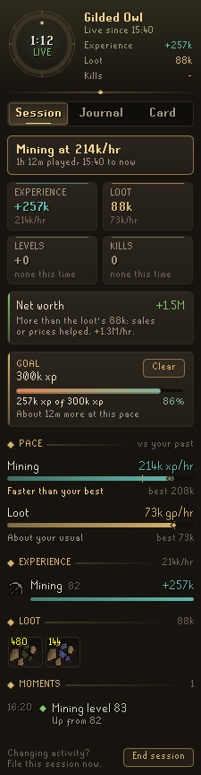
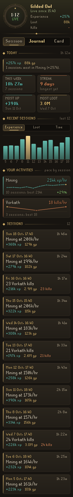
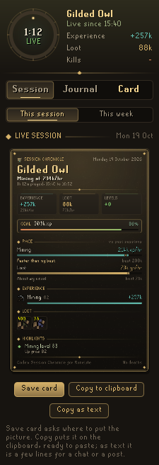
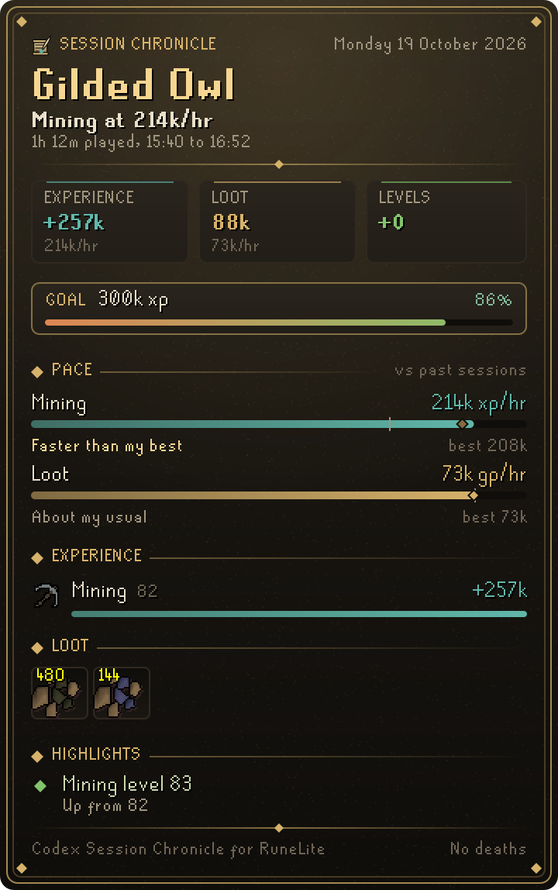
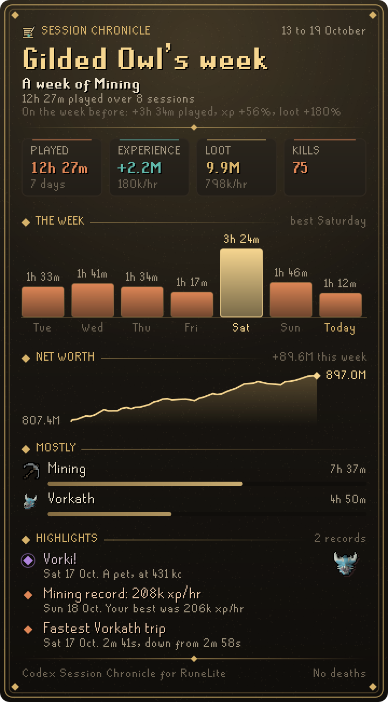
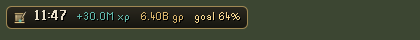

# Codex Session Chronicle

**Every play session, written down for you.** Codex Session Chronicle keeps the story of each session as you play: the experience every skill gained, the levels you reached, the loot that dropped, what you killed and the moments worth telling. When the session ends it goes into a journal, and any session or week can be shared as a card.

It is part of the **Codex** suite and shares its look: warm ink, aged gold and the game's own fonts.

<p align="center">
  
  
  
</p>

## What you get

- **Session.** A clock that fills through each hour you play, a headline ("99 Ranged!", "24 Vorkath kills", "Mining at 214k/hr"), experience and loot with their hourly rates, levels and kills, then every skill trained, the best loot and the session's moments.
- **Pace.** Your main skill's experience an hour, kills an hour and loot an hour set beside your earlier sessions of the same kind: "Faster than your best", "About your usual".
- **Goals.** Give the session a goal with one click (experience, loot, kills or play time), with offers drawn from your own journal, and see when you should reach it at your pace.
- **Trips.** Each trip out from the bank and back, timed in play time, with what it brought; your average and quickest.
- **Slayer.** Your task: how many are left, your kill rate and when it should be done.
- **Moments.** Levels, pets, new collection log slots, valuable drops, quests, diaries, clue scrolls, personal bests and deaths, each with its time. Personal records (your fastest Mining yet, your quickest Vorkath trip, your richest session) become moments when a session ends.
- **Journal.** The day so far, then every finished session, newest first, with your records and your activities.
- **Cards.** The session, or the last seven days, as a picture to save or copy, or as text to paste into a chat.
- **Ticker.** An optional slim plaque in the game view with the session's clock, experience and loot.

<p align="center">
  
  
</p>
<p align="center">
  
</p>

## Settings that matter

| Setting | What it does |
| --- | --- |
| Break allowance | Log back in within this long and the same session carries on; stay away longer and a new one begins. 15 minutes by default. |
| Sessions kept | How many finished sessions the journal keeps for each account. |
| Notable drop value | A single drop worth at least this many coins becomes one of the session's moments. |
| Session ticker | The plaque in the game view. Off by default. |
| Recap last session, Goal reached in chat | Lines in the chat box when a new session begins and when the session's goal is reached. |
| Name on cards | Writes your character's name on the cards and their text. On by default. |
| Worth on cards | Shows how your net worth moved, by Codex Ledger, on the week card. Off by default. |

## With other Codex plugins

Session Chronicle works on its own. With **[Codex Ledger](https://github.com/Nubles/OSRS-Codex-Ledger)** installed it reads (never writes) your saved net worth, so the Session tab can show how your worth moved set against the loot ("more than the loot: sales or prices helped"), and the week card can draw your worth over the week.

Codex Ledger, Gear Roadmap and Navigator read the journal this plugin saves.

## How sessions work

A session begins when you log in. World hops never end it, and logging out and back in within the break allowance carries it on. Play time only counts while you are logged in. Experience is measured from your first reading of each skill in the session, and loot is priced at the Grand Exchange price when it dropped. Sessions are saved per account in your RuneLite profile, also as the client closes. A journal damaged in part keeps every session that can still be read; one that cannot be read at all is set aside rather than written over.

## Rules posture

Session Chronicle only reads what the game already shows you: your experience, loot events and the game's own chat messages. It does not click, change menus or send anything over the network. A card is only written when you press Save and pick where it goes.

## Development

```bash
./gradlew build   # compile and run tests
./gradlew run     # launch RuneLite with the plugin loaded
```
