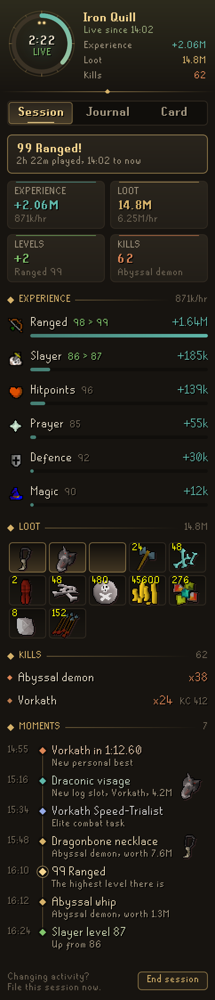
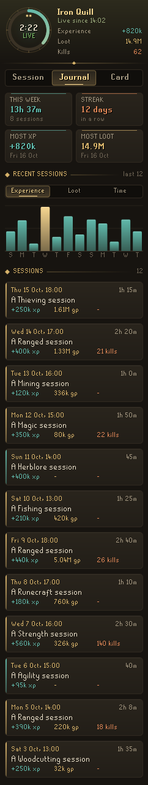
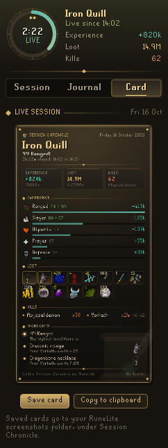
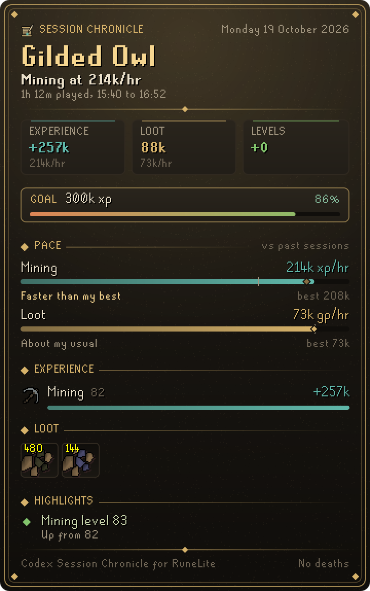
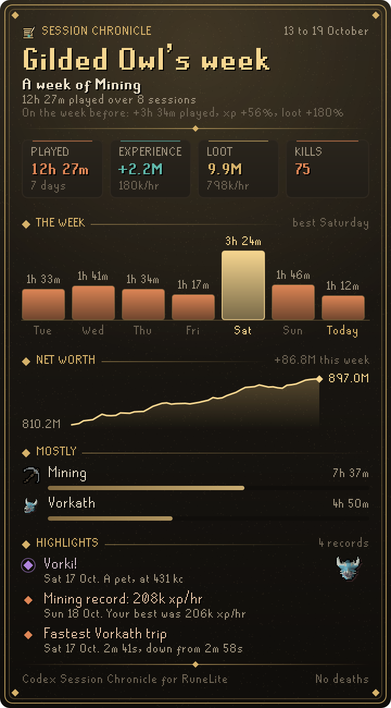
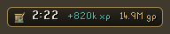
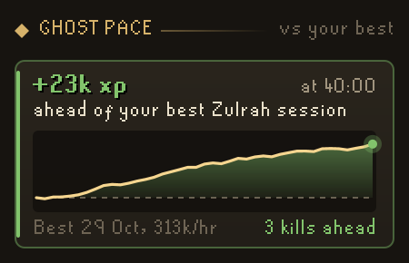
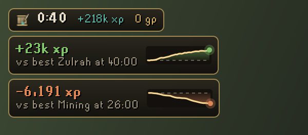
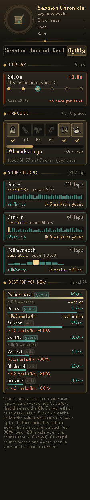
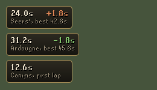

# Codex Session Chronicle

**Every play session, written down for you.** Codex Session Chronicle keeps the story of each session as you play: the experience every skill gained, the levels you reached, the loot that dropped, what you killed and the moments worth telling. When the session ends it goes into a journal, and any session or week can be shared as a card.

It is part of the **Codex** suite and shares its look: warm ink, aged gold and the game's own fonts.

<p align="center">
  
  
  
</p>

## What you get

- **Session.** A clock that fills through each hour you play, a headline ("99 Ranged!", "24 Vorkath kills", "Mining at 214k/hr"), experience and loot with their hourly rates, levels and kills, then every skill trained, the best loot and the session's moments.
- **Profit.** Food eaten, potion doses drunk, and runes, ammunition and cannonballs used are priced and taken off the loot, so you see what the session really made. Items dropped, banked or lost on death are not counted as used.
- **Laps and rounds.** Rooftop laps and skilling minigames (Wintertodt, Tempoross, Guardians of the Rift, Mahogany Homes, Giants' Foundry, herbiboar) get their own list, a rounds goal, rounds an hour in Pace and headlines like "48 Seers' Village Rooftop laps". They never count as kills.
- **Pace.** Your main skill's experience an hour, kills an hour and loot an hour set beside your earlier sessions of the same kind: "Faster than your best", "About your usual".
- **Ghost pace.** Race yourself. While a session runs, it is set against your own best earlier session of the same main activity (the same boss, or the same skill), at the same minute of play: "+23k xp ahead of your best Zulrah session at 40:00". A small line shows the gap minute by minute, green while you are ahead and ember while you are behind, and a boss race sets the kills side by side too ("3 kills ahead"). The best session is the fastest one in experience an hour of 15 minutes or more, so the rival stays the same all session. Every session now keeps where it stood each minute of play (fewer marks in the journal, so it stays small), and a ghost from before that is raced at its average pace and says so. Turn on *Ghost plaque* for the same race in a slim plaque in the game view.
- **Goals.** Give the session a goal with one click (experience, loot, kills, laps and rounds, or play time), with offers drawn from your own journal, and see when you should reach it at your pace.
- **Trips.** Each trip out from the bank and back, timed in play time, with what it brought; your average and quickest.
- **Slayer.** Your task: how many are left, your kill rate and when it should be done.
- **Moments.** Levels, pets, new collection log slots, valuable drops, quests, diaries, clue scrolls, personal bests and deaths, each with its time. Personal records (your fastest Mining yet, your quickest Vorkath trip, your richest session) become moments when a session ends.
- **Journal.** The day so far, then every finished session, newest first, with your records and your activities.
- **Cards.** The session, or the last seven days, as a picture to save or copy, or as text to paste into a chat.
- **Rooftop coach.** The Agility tab times every rooftop lap in game ticks, start to start, and keeps your best lap on each course as a ghost: the lap under way is set against it obstacle by obstacle ("1.8s behind at obstacle 3", "on pace for 44.4s"). Each course you run keeps its laps, best and usual lap, the recent laps as a little chart, experience an hour and the marks of grace you actually found. A Graceful card shows the pieces you own (seen in your bank, worn or carried), the marks you have, the marks still to find and about how long that takes at your pace. *Best for you now* ranks every course you can run by experience an hour, from your own laps once you have five on a course and the wiki's rates before that, each labelled, with marks an hour beside it, including the 80% cut 20 levels over a course. Your best laps become session moments. Turn on *Lap plaque* for the lap and its gap in the game view. Obstacles are not highlighted here, since RuneLite's own Agility plugin already does that.
- **Ticker.** An optional slim plaque in the game view with the session's clock, experience and loot.

<p align="center">
  
  
</p>
<p align="center">
  
</p>
<p align="center">
  
  
</p>
<p align="center">
  
  
</p>

## Settings that matter

| Setting | What it does |
| --- | --- |
| Break allowance | Log back in within this long and the same session carries on; stay away longer and a new one begins. 15 minutes by default. |
| Sessions kept | How many finished sessions the journal keeps for each account. |
| Notable drop value | A single drop worth at least this many coins becomes one of the session's moments. |
| Session ticker | The plaque in the game view. Off by default. |
| Ghost pace | Races the session against your best earlier session of the same activity on the Session tab. On by default. |
| Ghost plaque | The same race in a slim plaque in the game view. Off by default. |
| Rooftop coach | Times rooftop laps, races your best lap, counts marks of grace toward Graceful and compares courses on the Agility tab. On by default. |
| Lap plaque | The lap under way and its gap to your best lap in a slim plaque in the game view. Off by default. |
| Recap last session, Goal reached in chat | Lines in the chat box when a new session begins and when the session's goal is reached. |
| Name on cards | Writes your character's name on the cards and their text. On by default. |
| Worth on cards | Shows how your net worth moved, by Codex Ledger, on the week card. Off by default. |

## With other Codex plugins

Session Chronicle works on its own. With **[Codex Ledger](https://github.com/Nubles/OSRS-Codex-Ledger)** installed it reads (never writes) your saved net worth, so the Session tab can show how your worth moved set against the loot ("more than the loot: sales or prices helped"), and the week card can draw your worth over the week.

Codex Ledger, Gear Roadmap and Navigator read the journal this plugin saves.

## How sessions work

A session begins when you log in. World hops never end it, and logging out and back in within the break allowance carries it on. Play time only counts while you are logged in. Experience is measured from your first reading of each skill in the session, and loot is priced at the Grand Exchange price when it dropped. Sessions are saved per account in your RuneLite profile, also as the client closes. A journal damaged in part keeps every session that can still be read, and any journal that could not be read whole, or holds fields only a later version knows, is first copied aside (one copy, under `journalUnreadable`) so the next session filed never writes over the only copy.

## Rules posture

Session Chronicle only reads what the game already shows you: your experience, loot events, the game's own chat messages and the items in your bank, inventory and worn equipment. It does not click, change menus or send anything over the network. A card is only written when you press Save and pick where it goes.

## Development

```bash
./gradlew build   # compile and run tests
./gradlew run     # launch RuneLite with the plugin loaded
```
