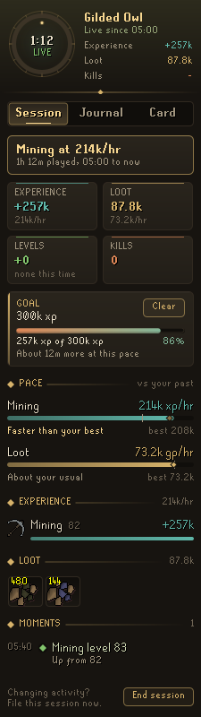
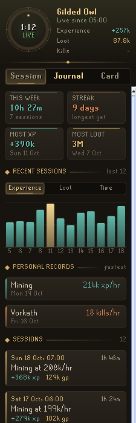

# Codex Session Chronicle

**Every play session, written down for you.** Codex Session Chronicle quietly keeps the story of each session as you play: the experience every skill gained, the levels you reached, the loot that dropped, what you killed and the moments worth telling. When the session ends it goes into a journal, and any session can be saved as a gilt-framed card to share.

It is the fifth plugin in the **Codex** suite, after [Codex Navigator](https://github.com/Nubles/OSRS-Codex-Navigator), [Codex Guardian](https://github.com/Nubles/OSRS-Codex-Guardian), [Codex Log Insight](https://github.com/Nubles/OSRS-Codex-Log-Insight) and [Codex Gear Roadmap](https://github.com/Nubles/OSRS-Codex-Gear-Roadmap), and shares their look: warm ink, aged gold and the game's own fonts.

<p align="center">
  
  
  
</p>

## What it does

- **Session.** A clock that fills through each hour you play, then the session at a glance: a headline ("99 Ranged!", "Draconic visage!", "24 Vorkath kills", "Mining at 192k/hr"), experience and loot with their hourly rates, levels gained and kills. Below that, every skill you trained with the levels it rose through, your loot laid out like bank slots, kills with the game's own kill count, and a timeline of the session's moments. Changing activity? **End session** files it in the journal and starts a fresh one straight away.
- **Trips.** Every trip out from the bank and back is timed in play time, with the kills, loot or experience it brought: a bar for each recent trip, your average and quickest, what a trip brings on average, and how long the trip under way has run. A trip ends when you open a bank or deposit box and the next begins when you close it; a quick visit with nothing done between is not a trip. The journal keeps each session's trip count, average and quickest.
- **Net worth, with Codex Ledger.** If you also use [Codex Ledger](https://github.com/Nubles/OSRS-Codex-Ledger), the Session tab shows how your net worth moved over the session, set against the loot, so you see what the supplies and everything else cost: "Loot 3.75M, so about 1.4M went on supplies and the rest." It reads Ledger's saved worth (Ledger saves every few minutes) and never writes it; without Ledger the card is simply not shown. In turn, Ledger's **What pays** reads the journal (each session's main activity and its worth at the start and end) to rank what earns you the most an hour.
- **Goals.** Give the session a goal with one click: experience, loot, kills or play time. The offers come from your own journal (your usual session, your best, and a little past your best), or round numbers until you have a few sessions. A bar shows how far you are and when you should get there at the pace so far; reaching it becomes a moment, a chat line and a mark on the ticker.
- **Pace.** Your main skill's experience an hour, your main monster's kills an hour and your loot an hour, each set beside your earlier sessions of the same kind: a tick at your usual, a gilt diamond at your best, and a word on how you are doing ("12% above your usual", "Faster than your best"). Only sessions of 15 minutes or more count, so a short burst never sets the bar.
- **Personal records.** When a session ends, any record it set becomes one of its moments: your fastest Mining yet, your fastest Vorkath trip, your richest session, your most experience. The Journal's **Your activities** section lists every skill and monster you have filed sessions of, with your best rate, a little line of your last dozen sessions' pace (the best one marked in gold), and whether you have been getting faster or slower lately. Your longest streak of days played is there too.
- **Slayer.** Your current task on the Session tab: how many are left of how many, a bar, how many you have killed this session, your kill rate and when the task should be done at that pace. Getting a task and finishing one are moments, and each finished task stays listed for the session. World hops keep the task and its pace: the game's task count blinks to nothing for a moment as you arrive in a new world, and that is waited out. Every kill also records the task it was made on, which [Codex Gear Roadmap](https://github.com/Nubles/OSRS-Codex-Gear-Roadmap) uses to weigh the slayer helmet's bonus fairly.
- **Moments.** Level ups and 99s, pets, new collection log slots, drops worth more than a value you choose, quests, achievement diaries, combat tasks, clue scrolls, personal bests and deaths (with what killed you), each with the time it happened. A big drop that is also a new log slot is one moment, not two.
- **Journal.** The day so far at the top (it turns over at midnight, logged in or not: time played, experience, loot and kills over every session begun today, the one under way included, and the skill most of it went to), then every finished session, newest first, with your records (most experience, most loot), your hours this week, your streak of days played, and a chart of recent sessions by experience, loot or time. Click any session to open it again, and **Remove** one you would rather not keep.
- **Card.** The session as a picture: your name, the headline, totals, its goal and pace against your past, top skills, best loot, kills and highlights on a gilt-framed page, drawn at double scale so the pixel fonts stay crisp. Save it wherever you choose with RuneLite's file chooser, or copy it straight to the clipboard. **Copy as text** puts the same session on the clipboard as a few plain lines (headline, totals, top skills, best loot, kills and moments) for a clan chat or a forum post.
- **Week card.** Beside the session's card, **This week** draws the last seven days on the same gilt page: a column for each day as tall as you played it with your best day in gold, the week's time, experience, loot and kills, what it mostly went on, its best moments (a personal record beaten twice that week is told once, by its latest), and, with [Codex Ledger](https://github.com/Nubles/OSRS-Codex-Ledger), a gilt line of your net worth through the week. Save it, copy it or copy it as text like a session card.
- **Ticker.** An optional slim plaque in the game view with the session's clock, experience and loot.

<p align="center">
  
  
</p>

<p align="center">
  
  
</p>

## How sessions work

A session begins when you log in. If you log out and come back within the break allowance (15 minutes by default), the same session carries on; stay away longer and it is filed in the journal, and the next login begins a new one. World hops never end a session. Play time only counts while you are logged in, and so does experience: anything you gain on another device during a break is left out, so the rates stay honest.

Experience is measured from your first reading of each skill in the session. Last Man Standing and the PvP Arena lend you stats for a while; those never count as progress. Loot comes from RuneLite's loot events, each item priced at the Grand Exchange price when it dropped. Monster kills are always seen; raids, chests and clue caskets come from RuneLite's Loot Tracker plugin, so keep it switched on to have them counted. Kills are counted from loot and from the game's kill count messages, whichever saw more, and the two are matched even when they spell a boss differently. Only real kills count as kills, toward the Kills total and a kills goal alike: monsters, and bosses, raids and chests the game keeps a kill count for. Bird nests, supply crates and clue caskets are listed apart under **Opened**.

When a new session begins, a line in the chat box recaps the one before. Both that and the ticker can be turned off in the settings, and the card can leave your name off.

## Rules posture

Session Chronicle only reads what the game already shows you: your experience, loot events, and the game's own chat messages. It does not click, change menus or send anything over the network. Sessions are saved per account in your RuneLite profile (also as the client closes), and a card is only written when you press Save and pick where it goes.

## Development

```bash
./gradlew build   # compile and run tests
./gradlew run     # launch RuneLite with the plugin loaded
```
